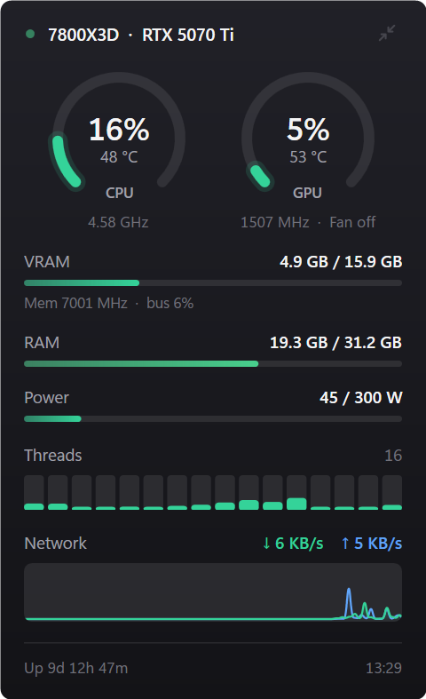
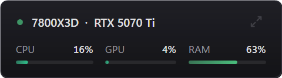

# ResGUI

A small, always-on-top system monitor overlay for Windows. It shows CPU, GPU, VRAM, RAM, power, per-thread load, network and temperatures in a dark panel that stays above your other windows, and you can hide or show it with a hotkey.

It is a single native `.exe` (C# / WPF, about 60 KB). There is nothing to install and no runtime to download.

<p align="center">
  
  <br><br>
  
</p>

## Features

- **CPU and GPU gauges** showing load %, temperature, clock speed and GPU fan status.
- **VRAM, RAM and power bars**, plus memory clock and memory-controller load.
- **Per-thread load bars** for every logical processor.
- **Network graph** of download and upload speed over the last 60 seconds.
- **Uptime and clock** in the footer.
- **Smooth animation**: values glide between readings at 60 fps, and colours shift from green to amber to red as load rises.
- **Global hotkey** (`Ctrl+Alt+R` by default) to hide and show the overlay with a fade.
- **Compact mode**: a single row of CPU, GPU and RAM meters.
- **Stays out of the way**: it is hidden from the taskbar and Alt+Tab, and clicking it never takes focus away from a game.
- **Tray icon and right-click menu** with:
  - Show/Hide
  - Compact
  - Click-through (mouse clicks pass through the overlay)
  - Opacity
  - Sections (turn parts of the panel on or off)
  - Start with Windows
  - Edit settings
  - Exit
- **Lightweight**: about 6% of one CPU core while visible, and close to zero while hidden.

## Requirements

- Windows 11, or Windows 10 (64-bit). On Windows 10 the corners are square.
- .NET Framework 4.8. This is built into Windows 10 version 1903 and later, and into Windows 11.
- **Optional:** an NVIDIA GPU, for the GPU, VRAM, power, clock and fan readings. They come from the NVIDIA driver's `nvml.dll`. Without one, the GPU sections are hidden.
- **Optional:** [LibreHardwareMonitor](https://github.com/LibreHardwareMonitor/LibreHardwareMonitor), for CPU temperature. See [CPU temperature](#cpu-temperature) below.

## Install

1. Download `ResGUI.exe` from the [latest release](https://github.com/Lampost-123/resgui-overlay/releases/latest).
2. Put it somewhere permanent, for example `C:\Tools\ResGUI\ResGUI.exe`.
3. Double-click it. The overlay appears in the top-right corner of your screen.
4. To start it automatically when you sign in, right-click the overlay and select **Start with Windows**.

> **Note:** the exe is not code-signed, so Windows SmartScreen may show "Windows protected your PC" the first time you run it. Click **More info**, then **Run anyway**. If you prefer, you can [build it from source](#build-from-source) instead.

## Usage

| Action | How |
| --- | --- |
| Hide or show | Press `Ctrl+Alt+R`, or left-click the tray icon |
| Move | Drag the overlay anywhere. Its position is remembered. |
| Compact mode | Click the arrows icon at the top right, or use the menu |
| Menu | Right-click the overlay or the tray icon |
| Hide parts of the panel | Menu, then **Sections** |
| Let clicks pass through | Menu, then **Click-through**. Use the tray icon to turn it off again. |
| Exit | Menu, then **Exit** |

## CPU temperature

Windows has no built-in way to read the CPU's internal temperature without a hardware driver. ResGUI doesn't ship a driver. Instead, it reads the temperature from LibreHardwareMonitor's local web server.

1. Install LibreHardwareMonitor, for example with:

   ```
   winget install LibreHardwareMonitor.LibreHardwareMonitor
   ```

   This also installs the signed PawnIO driver that it uses to read the sensors.

2. Run LibreHardwareMonitor as administrator.
3. Select **Options → Remote Web Server → Run**.
4. Optional: select **Options → Run On Windows Startup**, **Start Minimized** and **Minimize To Tray**, so it runs quietly in the background.

Within about 2 seconds, ResGUI shows the CPU temperature (the `Core (Tctl/Tdie)` or `Package` sensor). If LibreHardwareMonitor isn't running, the temperature shows as `– °C`.

If you change LibreHardwareMonitor's port (**Options → Remote Web Server → Port**), set the same number as `LhmPort` in ResGUI's settings.

If Windows Firewall asks about LibreHardwareMonitor, you only need to allow **Private networks**. ResGUI connects from the same PC, so it works either way.

## Settings

Settings are stored in `%APPDATA%\ResGUI\settings.ini`. To open the file, use the menu and select **Edit settings...**. Restart ResGUI after editing it.

| Key | Default | Meaning |
| --- | --- | --- |
| `Hotkey` | `Ctrl+Alt+R` | Show/hide hotkey. Modifiers: `Ctrl`, `Alt`, `Shift`, `Win`. Keys: letters, digits, `F1`–`F24`, and so on. Examples: `Ctrl+Shift+F10`, `Win+Alt+H`. |
| `Fps` | `60` | Animation frame rate (15–240). Lower uses less CPU. |
| `Opacity` | `1` | Opacity of the whole window, from `0.2` to `1`. You can also set this from the menu. |
| `LhmPort` | `8085` | LibreHardwareMonitor web server port. |
| `Compact` | `false` | Start in compact mode. |
| `Hidden` | *(empty)* | Comma-separated sections to hide: `Gauges`, `Memory + power`, `Threads`, `Network`, `Uptime + clock`. |
| `Left`, `Top` | *(top-right)* | Window position. This is saved automatically when you drag the overlay. |

If the hotkey is already used by another app, ResGUI shows a tray notification. Pick a different combination in `Hotkey`.

## Where the numbers come from

| Reading | Source |
| --- | --- |
| CPU load, per-thread load | `NtQuerySystemInformation` (processor performance information) |
| CPU clock | Windows performance counter `Processor Information\% Processor Performance`. This is the same "Speed" value Task Manager shows. |
| CPU temperature | LibreHardwareMonitor web server (`/data.json`) |
| RAM | `GlobalMemoryStatusEx` |
| GPU load, VRAM, power, clocks, fan, temperature | NVIDIA NVML (`nvml.dll`, installed with the NVIDIA driver) |
| Network | .NET `NetworkInterface` statistics. Only adapters with a default gateway are counted, so virtual adapters aren't double-counted. |
| Uptime | `GetTickCount64` |

Readings are taken twice a second.

When the GPU shows **Fan off**, the reading is correct: most modern cards stop their fans when idle and start them under load.

## Build from source

No SDK is needed. The build uses the C# compiler that ships with Windows.

```
git clone https://github.com/Lampost-123/resgui-overlay.git
cd resgui-overlay
build.bat
```

This produces `ResGUI.exe` next to the source. The project is a single file, [`ResGUI.cs`](ResGUI.cs), written in C# 5 syntax so the built-in compiler can build it.

| File | Purpose |
| --- | --- |
| `ResGUI.cs` | The whole app: sensors, UI, animation, tray, hotkey, settings |
| `build.bat` | Compiles with `%WINDIR%\Microsoft.NET\Framework64\v4.0.30319\csc.exe` |
| `ResGUI.ico` | App icon. `tools/make-icon.ps1` regenerates it. |
| `tools/screenshot.ps1` | Captures the running overlay to a PNG, as used for the images above |

## Troubleshooting

- **The hotkey does nothing.** Another app has already registered it, and ResGUI shows a tray notification when this happens. Change `Hotkey` in the settings, then restart ResGUI.
- **CPU temperature shows `– °C`.** LibreHardwareMonitor isn't running as administrator, its web server is off, or `LhmPort` doesn't match its port.
- **The overlay doesn't appear over a game.** Games in *exclusive* fullscreen draw over every window. Switch the game to borderless windowed mode.
- **There are no GPU sections.** No NVIDIA GPU or driver was found. AMD and Intel GPUs aren't supported yet.

## License

[MIT](LICENSE)
